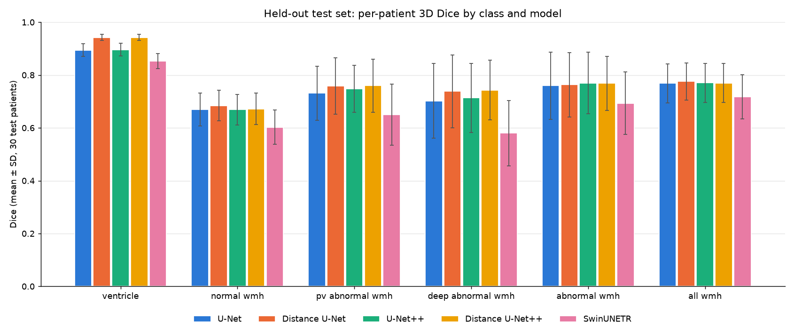
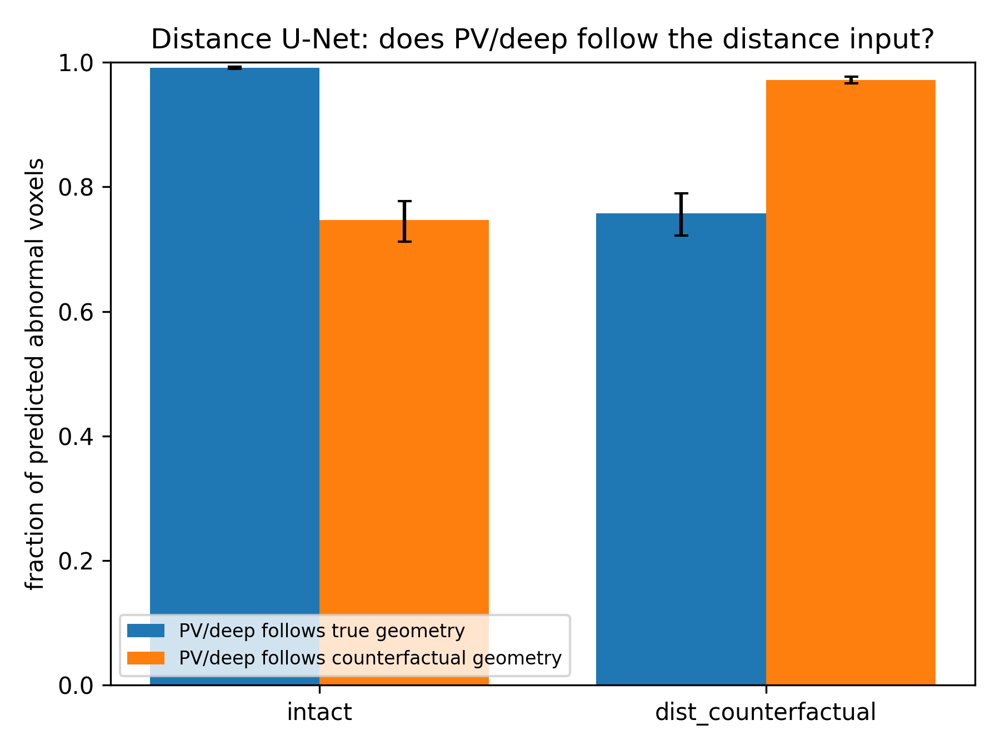
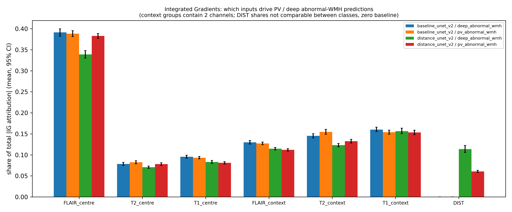

# Ventricle-Distance-Conditioned WMH Segmentation (MS3SEG)

This project segments white-matter hyperintensities (WMH) and splits abnormal WMH into **periventricular (PV)** and **deep** lesions in brain MRI (T1, T2, FLAIR) from the MS3SEG dataset.

The core idea is to give a 2D segmentation network one extra input channel: a normalized **3D distance-to-ventricle map**. The PV/deep label is defined by distance (PV ≤ 10 mm from the ventricles, deep > 10 mm). We test whether supplying that geometry directly improves the PV/deep split compared with models that must infer it from the image alone.

## Labels

| Label | Class | Definition |
|---|---|---|
| 0 | Background | |
| 1 | Ventricle | |
| 2 | Normal WMH | |
| 3 | PV abnormal WMH | abnormal WMH with distance to ventricle ≤ 10 mm |
| 4 | Deep abnormal WMH | abnormal WMH with distance to ventricle > 10 mm |

We also report two merged targets: `abnormal_wmh` (3+4) and `all_wmh` (2+3+4).

## Headline results: held-out test set (30 patients)

The comparison uses per-patient 3D Dice, mean ± SD. Each model was trained on the 70 development patients and evaluated on the test set **once**. Epoch count, LR schedule and post-processing were all fixed on 5-fold CV beforehand.



| Class | U-Net | **Distance U-Net** | U-Net++ | **Distance U-Net++** | SwinUNETR |
|---|---|---|---|---|---|
| Ventricle | 0.894 ± 0.024 | **0.942 ± 0.012** | 0.896 ± 0.024 | **0.942 ± 0.011** | 0.853 ± 0.029 |
| Normal WMH | 0.669 ± 0.062 | **0.684 ± 0.058** | 0.669 ± 0.058 | 0.672 ± 0.060 | 0.603 ± 0.065 |
| PV abnormal WMH | 0.731 ± 0.103 | 0.758 ± 0.107 | 0.748 ± 0.088 | **0.760 ± 0.100** | 0.650 ± 0.115 |
| Deep abnormal WMH | 0.702 ± 0.142 | 0.738 ± 0.137 | 0.714 ± 0.131 | **0.743 ± 0.113** | 0.580 ± 0.124 |
| Abnormal WMH (PV+deep) | 0.760 ± 0.127 | 0.763 ± 0.122 | **0.770 ± 0.116** | 0.768 ± 0.102 | 0.693 ± 0.118 |
| All WMH | 0.769 ± 0.074 | **0.776 ± 0.071** | 0.770 ± 0.074 | 0.770 ± 0.074 | 0.717 ± 0.084 |
| Abnormal WMH HD95 (mm) | 10.40 | 10.72 | 11.31 | **10.28** | 13.55 |
| Input channels | 9 | 10 | 9 | 10 | 9 |

The full table, including sensitivity, precision, HD95 for every class and CV mean ± SD, is in [results/comparison/model_comparison.csv](results/comparison/model_comparison.csv).

### What the results show

- **The distance channel mainly improves the PV/deep split, not lesion detection.** Merged abnormal-WMH Dice barely changes (0.760 → 0.763 for U-Net). PV Dice rises by about 0.03 and deep Dice by about 0.04, for both U-Net and U-Net++.
- **The distance channel also improves ventricle segmentation** (0.894 → 0.942).
- **CV and test agree.** For example, Distance U-Net abnormal WMH scores 0.761 ± 0.012 on CV and 0.763 on test, so there is no sign of overfitting to the test set.
- **SwinUNETR performs worst on every class** in this small-data 2.5D setting.
- **Post-processing removed nothing.** Small-component removal was offered on CV, and the CV choice for every model was 0 voxels (no removal).

## Explainability (script 19)

Script 19 compares the final baseline U-Net v2 with the final Distance U-Net v2 on the 30 test patients. Results are in [results/explainability/](results/explainability/).

| Analysis | Finding |
|---|---|
| **PV/deep label agreement** (is a predicted abnormal voxel given the PV/deep label that matches its true distance?) | Baseline 0.954 vs Distance 0.989. The largest gains are in the 5–10 mm band (+0.045) and the 10–20 mm band (+0.042), next to the 10 mm boundary. |
| **Zeroing the distance channel** | Abnormal Dice collapses from 0.763 to 0.087. The distance model depends heavily on this input. |
| **Counterfactual distance map** (another patient's ventricles) | The PV/deep labels follow the swapped geometry: 97% of predicted abnormal voxels match the counterfactual geometry. Lesion detection barely changes (Dice −0.03), but PV and deep Dice each drop by about 0.20. This shows the model *uses* the distance input to decide PV vs deep. |
| **Channel ablation** | FLAIR is essential for both models (Dice → 0 without it). The baseline relies much more on neighbouring slices (−0.054 without them) than the distance model does (+0.001). |
| **Integrated Gradients** | FLAIR (centre slice) gets the largest attribution share (0.34–0.39). The distance channel takes 0.11 of the share for deep WMH and 0.06 for PV WMH. |
| **10 mm rule-based relabelling of the baseline** | Applying the 10 mm rule after the baseline's prediction lifts its PV/deep Dice to near the distance model (PV 0.762, deep 0.753). This is a strong, simple alternative and should be reported alongside the learned model. |




## Pipeline

| Script | Stage |
|---|---|
| `01`–`08` | Dataset extraction, manifest, file-mapping, geometry and mask validation, visual QC |
| `09`–`11` | Preprocessing plan, preprocessing, validation of the preprocessed data |
| `12_create_split_and_slices.py` | Locked 70/30 patient split, 5-fold CV on the 70, 2D slice export |
| `15a_make_ventricle_distance.py` | 3D Euclidean distance to the ventricle mask (mm), normalized as `min(d, 35 mm) / 35 mm`; D_max is chosen on the development set only |
| `15b_make_six_class_masks.py` | 5-class ground truth (PV/deep split at 10 mm) |
| `16a_check_distance_alignment.py` | Checks that every slice gets its own patient's distance map |
| `14_train_baseline_unet_v2.py` | Baseline U-Net v2 (9 channels) |
| `16_distance_map_unet.py` | Distance U-Net v1 (plain 2D, 4 channels; superseded by 17) |
| `17_distance_map_unet_v2.py` | **Distance U-Net v2** (2.5D, 10 channels) |
| `18_train_baseline_swin_unetr_v2.py` | SwinUNETR baseline |
| `20_train_unetpp_v2.py` | U-Net++ baseline |
| `21_distance_map_unetpp.py` | Distance U-Net++ |
| `19_explainability.py` | Ablation, counterfactual, Integrated Gradients, distance bands, uncertainty, rule-based comparison |
| `collect_results.py` | Copies summary metrics and plots from `logs/` into `results/` and draws the comparison chart |
| `unet2d.py` | U-Net building blocks |
| `view.py`, `view_dist.py` | Quick viewers for prediction and label NIfTI files (edit the hard-coded paths) |

### Training protocol (all v2 models)

- **Input:** 2.5D input. T1/T2/FLAIR for slices z−1, z and z+1 give 9 channels, plus the distance channel for the distance models, giving 10.
- **Loss:** cross-entropy (class weights ∝ 1/freq^0.5) + batch-level soft Dice (background excluded).
- **Optimizer:** AdamW at 1e-4 with cosine annealing to 1e-6, AMP, and a seed reset per fold.
- **Augmentation:** flips and rot90. Intensity scale and shift are applied to brain voxels of the MRI channels only; the distance channel is never intensity-augmented.
- **Model selection:** best epoch is chosen by patient-level 3D Dice of abnormal WMH.
- **Final model:** retrained on all 70 development patients for the median of the 5 CV best epochs.
- **Test-time augmentation:** flip TTA (4 flips, mean of softmax outputs).
- **Evaluation:** against the full 3D ground-truth volume. Dice and sensitivity are averaged only over patients who have that class, and NaN HD95 values are counted and reported.
- **Single test run:** the test set is evaluated once, and the script refuses to re-run once test results exist.

### Running

```bash
pip install -r requirements.txt
python 17_distance_map_unet_v2.py --smoke        # quick check on a few dev patients
python 17_distance_map_unet_v2.py                # 5-fold CV + final model + test
python 17_distance_map_unet_v2.py --no-distance  # same pipeline without the distance channel
python collect_results.py                        # refresh results/
```

A CUDA GPU is required. Add `--allow-cpu` only for debugging.

## Repository contents

The repository holds code, summary metrics and aggregate plots only. These are **not** included (see `.gitignore`):

- MRI data, preprocessed volumes, distance maps and masks (`*.nii.gz`)
- model checkpoints (`*.pth`)
- full training logs
- per-patient prediction images

The MS3SEG dataset must be taken from its original source.

```
results/
  comparison/              model_comparison.csv, test_dice_comparison.png
  <model run>/
    cv_summary/            CV mean ± SD, post-processing choice, CV plots
    final_results/         final plan, test30 summary, training curves,
                           test Dice / HD95 boxplots, confusion matrix, volume agreement
  explainability/          ablation, attribution, distance-band, rule-based, uncertainty summaries
```
